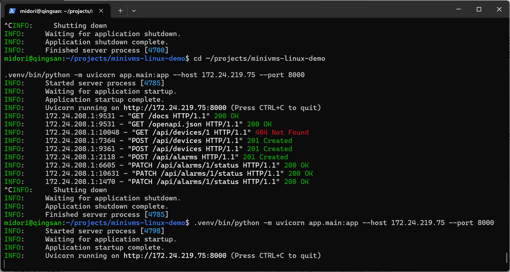

# MiniVMS Linux 部署说明

## 1. 本次环境

| 项目 | 实际记录 |
|---|---|
| 运行方式 | Windows 上的 WSL2 Ubuntu |
| Linux 发行版 | Ubuntu 26.04.1 LTS（终端截图） |
| Linux 用户 | `midori` |
| 项目目录 | `/home/midori/projects/minivms-linux-demo` |
| Python 环境 | 项目内 `.venv`，实际版本尚未单独记录 |
| 数据库 | 项目根目录 `minivms.db`，SQLite |
| 原系统 | `http://172.24.219.75:8000` |
| 恢复副本 | `http://172.24.219.75:8001` |

以上 IP 是本次演练时的 WSL 地址，重新启动 WSL 后可能变化。Ubuntu 中可运行 `hostname -I` 查看地址。命令中的地址需与当前环境一致。

## 2. 环境准备参考

下面是本项目的环境准备方式。已有部署应直接使用第 3 节的启动命令；本次没有逐项保存首次安装日志，因此安装段作为复现说明，不能视为再次安装通过的记录。

在 Windows PowerShell 中进入已安装的 Ubuntu：

```powershell
wsl -d Ubuntu
```

下面的命令在 Ubuntu 中运行：

```bash
sudo apt update
sudo apt install -y git curl sqlite3
curl -LsSf https://astral.sh/uv/install.sh | sh
source "$HOME/.local/bin/env"
uv python install 3.14
mkdir -p ~/projects
cd ~/projects
git clone https://github.com/Kalen0611/mini-vms-test.git minivms-linux-demo
cd minivms-linux-demo
uv venv --python 3.14
uv pip install -r requirements.txt
```

项目 README 记录 Python 3.14；复现时应以环境的实际版本和依赖安装结果为准。网络访问失败时应处理网络或代理配置，保留报错，不随意删除依赖版本约束。

## 3. 本次实际启动命令

在 Ubuntu 中进入项目目录并启动：

```bash
cd ~/projects/minivms-linux-demo
.venv/bin/python -m uvicorn app.main:app --host 172.24.219.75 --port 8000
```

出现 `Application startup complete` 和运行地址后，在浏览器访问：

- [应用首页](http://172.24.219.75:8000/)
- [接口操作页面](http://172.24.219.75:8000/docs)

此方式在当前终端前台运行，需要保持终端开启。尚未配置后台服务管理、开机启动或异常自动重启。

## 4. 停止与重新启动

在运行服务的终端按 `Ctrl + C`，等待 `Application shutdown complete`、`Finished server process`。在同一目录重新执行启动命令。

本次已验证：重启后通过接口重新查询，设备 ID 1、2 仍存在，告警 ID 1 的“已关闭”状态和处理说明仍存在。浏览器中保留旧结果不能代替重启后重新执行查询。



## 5. 后续需要补录的版本信息

这些命令用于补充环境记录，尚未取得本次实际输出：

```bash
cd ~/projects/minivms-linux-demo
.venv/bin/python --version
.venv/bin/python -m pip --version
sqlite3 --version
git rev-parse HEAD
```

如果虚拟环境未安装 pip，可使用 `uv pip list --python .venv/bin/python` 查看依赖。记录实际代码提交编号，便于其他人复现同一版本。

