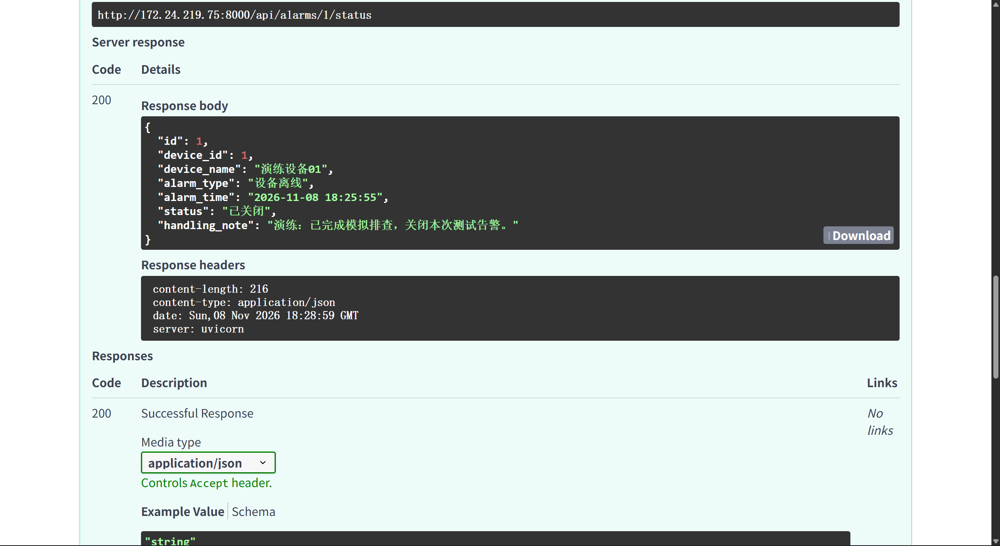

# MiniVMS 用户操作与权限说明

## 1. 打开操作页面

本次原系统使用 `http://172.24.219.75:8000/docs`，恢复副本使用 `http://172.24.219.75:8001/docs`。操作前确认端口。点击接口行展开，点击 `Try it out`，填写参数或 JSON，再点击 `Execute`，查看 `Server response` 下的实际状态码与返回内容。

## 2. 创建与查询设备

接口：`POST /api/devices`。新增第一台设备时填写：

```json
{
  "name": "演练设备01",
  "ip_address": "192.168.1.101",
  "port": 8000,
  "device_type": "网络摄像机"
}
```

本次返回 HTTP 201，设备 ID 为 1，初始状态为“离线”。第二台设备名称为“演练设备02”，IP 为 `192.168.1.102`，端口为 8001，返回 ID 为 2。

这些 IP 是演练记录，不代表程序实际连接了摄像机。当前设备状态由接口更新，不能据此声称实现了真实设备在线探测。

使用 `GET /api/devices` 查询列表，状态筛选保持空白可查询全部记录。`GET /api/devices/{device_id}` 查询指定设备。

## 3. 创建与处理告警

在 `POST /api/alarms` 中填写：

```json
{
  "device_id": 1,
  "alarm_type": "设备离线"
}
```

本次返回 HTTP 201，告警 ID 为 1，初始状态为“新产生”。此为手动创建的模拟告警，不是由设备真实故障自动触发。

在 `PATCH /api/alarms/{alarm_id}/status` 中填写 `alarm_id=1`、请求头 `x-user-role=operator`。按顺序执行下面三个请求，每次确认 HTTP 200 后再进行下一次：

```json
{"status": "已确认"}
```

```json
{"status": "处理中"}
```

```json
{
  "status": "已关闭",
  "handling_note": "演练：已完成模拟排查，关闭本次测试告警。"
}
```

状态顺序为“新产生 → 已确认 → 处理中 → 已关闭”。关闭时必须填写有效处理说明。重复执行同一状态更新可能因不符合下一状态要求而返回 409，应先查询当前状态。

使用 `GET /api/alarms/1` 核对关闭状态和处理说明。



## 4. 当前代码中的权限规则

| 操作 | 当前接口行为 |
|---|---|
| 修改设备基本信息、删除设备 | 要求请求头 `X-User-Role: admin` |
| 处理告警状态 | 要求角色为 `admin` 或 `operator`；`visitor` 被拒绝 |
| 新增或查询设备、更新设备状态 | 当前相应接口没有角色依赖校验 |
| 新增或查询告警 | 当前相应接口没有角色依赖校验 |

当前登录接口验证演示账户，但不签发与后续请求绑定的登录令牌。权限角色由客户端自行填写，请求头可以被修改，因此该实现用于演示角色规则，不能认定为完整的身份认证或安全授权。角色文档必须同时说明这一边界。

后续改进可将角色与服务器验证的登录身份绑定，增加密码哈希、令牌或会话验证，并为所有应受保护的接口设置相应限制。这些改进尚未在本次演练中实现或验收。

## 5. 常见状态码

| 状态码 | 本项目中的常见含义 |
|---|---|
| 200 | 查询或修改成功 |
| 201 | 新增成功 |
| 400 | 业务输入不符合要求，例如关闭告警时处理说明无效 |
| 401 | 登录凭据不正确 |
| 403 | 当前填写的角色无权执行操作 |
| 404 | 设备或告警不存在 |
| 409 | IP 与端口重复，或告警状态流转冲突 |
| 422 | 必填项缺失、类型或范围不符合模型要求 |

具体原因以响应中的 `detail` 为准。

