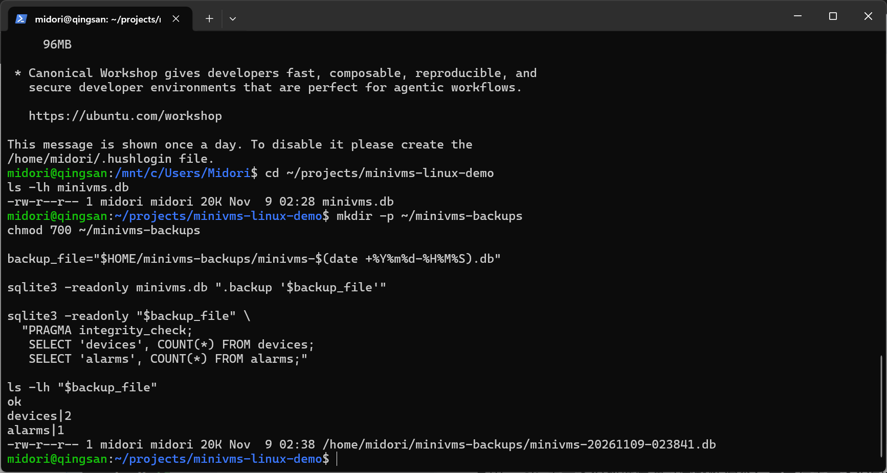
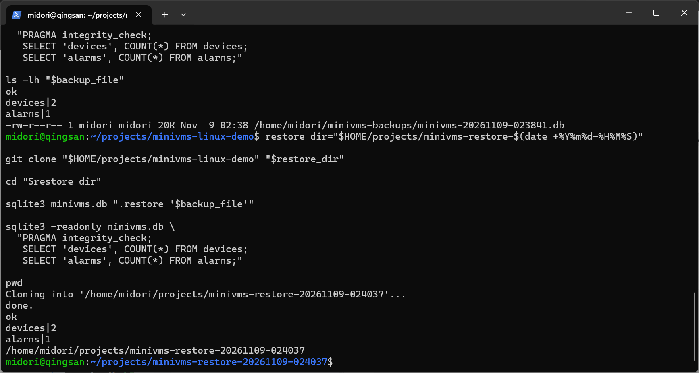
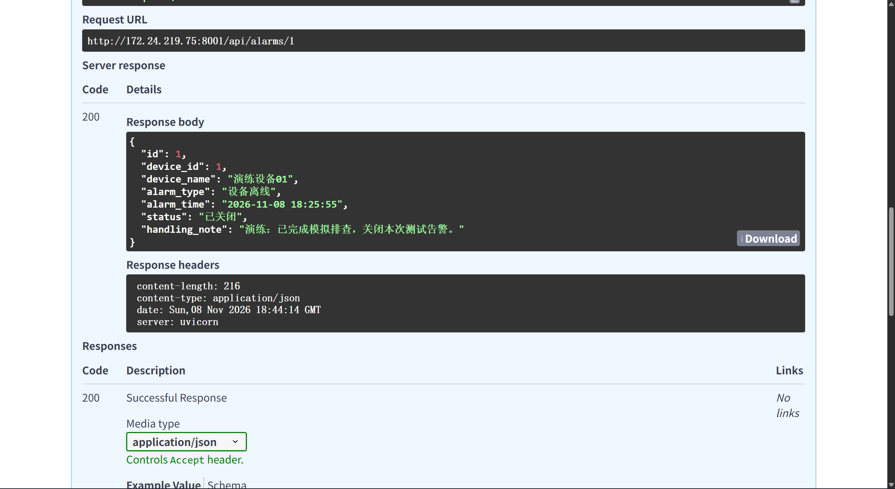
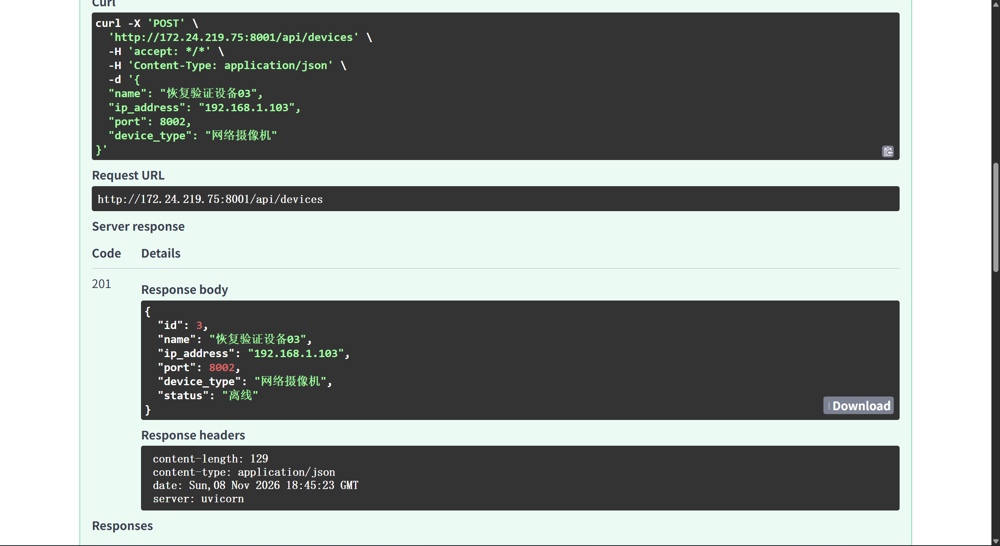
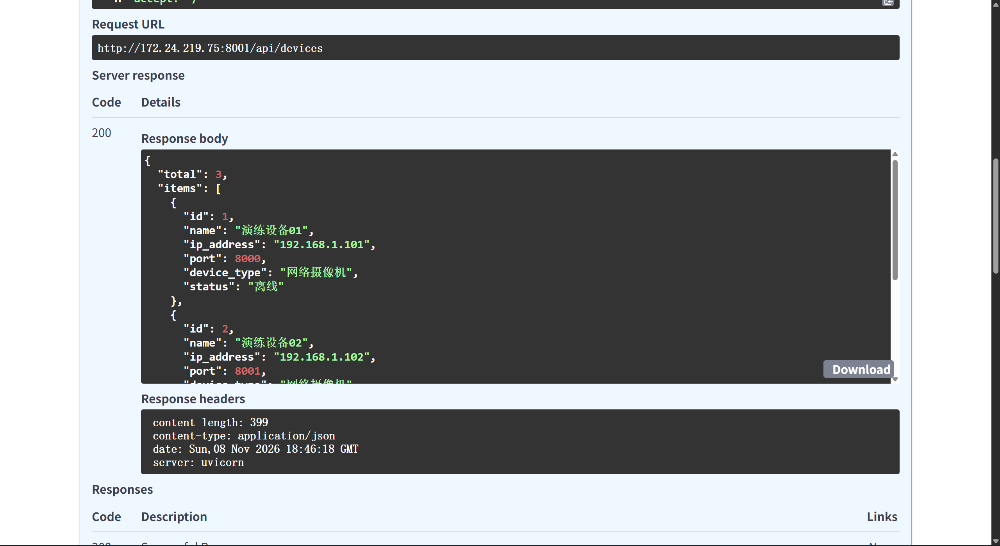
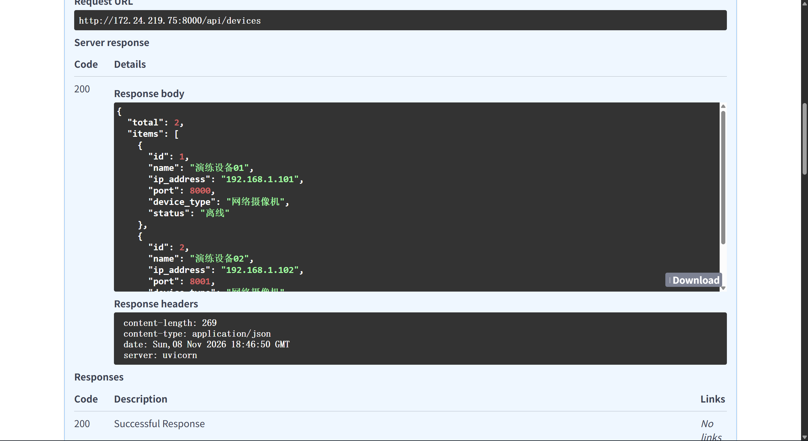

# MiniVMS SQLite 备份恢复演练记录

## 1. 演练范围及实际路径

日期：2026-11-09（Asia/Shanghai）。本次使用人工执行的 SQLite 备份和独立项目目录恢复，不包含定时备份、跨机器灾难恢复或恢复时间指标测试。

| 项目 | 本次实际值 |
|---|---|
| 原项目 | `/home/midori/projects/minivms-linux-demo` |
| 原数据库 | `/home/midori/projects/minivms-linux-demo/minivms.db` |
| 备份文件 | `/home/midori/minivms-backups/minivms-20261109-023841.db` |
| 备份大小 | `ls -lh` 显示约 20 KB |
| 恢复目录 | `/home/midori/projects/minivms-restore-20261109-024037` |
| 恢复数据库 | 恢复目录中的 `minivms.db` |
| 原服务端口 / 恢复端口 | 8000 / 8001 |

## 2. 备份前数据

- 设备 1：演练设备01，`192.168.1.101:8000`。
- 设备 2：演练设备02，`192.168.1.102:8001`。
- 告警 1：关联设备 1，类型“设备离线”，状态“已关闭”。
- 告警处理说明：`演练：已完成模拟排查，关闭本次测试告警。`

已先停止并重新启动服务，再重新发送查询请求确认上述数据保留。

## 3. 本次备份方法

在 Ubuntu 项目目录执行：

```bash
cd ~/projects/minivms-linux-demo
mkdir -p ~/minivms-backups
chmod 700 ~/minivms-backups
backup_file="$HOME/minivms-backups/minivms-$(date +%Y%m%d-%H%M%S).db"
sqlite3 -readonly minivms.db ".backup '$backup_file'"
sqlite3 -readonly "$backup_file" \
  "PRAGMA integrity_check;
   SELECT 'devices', COUNT(*) FROM devices;
   SELECT 'alarms', COUNT(*) FROM alarms;"
ls -lh "$backup_file"
```

实际检查结果：

```text
ok
devices|2
alarms|1
```

本次使用 SQLite 的 `.backup` 命令生成数据库备份。完整性检查用于检查数据库结构，记录数量用于初步核对；两者不能单独替代恢复后业务验证。



## 4. 独立目录恢复

在同一个 Ubuntu 终端中执行以下方式。`backup_file` 必须指向上一节生成的有效备份；如果终端已关闭，可重新指定本次实际路径：

```bash
backup_file="$HOME/minivms-backups/minivms-20261109-023841.db"
```

创建新的恢复目录：

```bash
restore_dir="$HOME/projects/minivms-restore-$(date +%Y%m%d-%H%M%S)"
git clone "$HOME/projects/minivms-linux-demo" "$restore_dir"
cd "$restore_dir"
sqlite3 minivms.db ".restore '$backup_file'"
sqlite3 -readonly minivms.db \
  "PRAGMA integrity_check;
   SELECT 'devices', COUNT(*) FROM devices;
   SELECT 'alarms', COUNT(*) FROM alarms;"
pwd
```

实际输出再次为 `ok`、`devices|2`、`alarms|1`。本次新目录为 `/home/midori/projects/minivms-restore-20261109-024037`。

本地 `git clone` 复制已提交代码，不会复制未提交修改或虚拟环境。复现时需确认代码版本与依赖兼容。此次复用原项目的 Python 虚拟环境；恢复副本的代码和数据库位于独立目录。



## 5. 启动恢复副本并验证

本次实际目录的启动方式：

```bash
cd ~/projects/minivms-restore-20261109-024037
"$HOME/projects/minivms-linux-demo/.venv/bin/python" -m uvicorn app.main:app \
  --host 172.24.219.75 \
  --port 8001
```

在浏览器打开 `http://172.24.219.75:8001/docs`，执行查询：

| 验证内容 | 实际结果 |
|---|---|
| `GET /api/devices` | HTTP 200，设备数 2，原设备 ID、名称、IP 和端口可查询 |
| `GET /api/alarms/1` | HTTP 200，告警关联设备 1，状态“已关闭”，处理说明一致 |



## 6. 恢复后写入及副本独立性

在 8001 端口执行 `POST /api/devices`：

```json
{
  "name": "恢复验证设备03",
  "ip_address": "192.168.1.103",
  "port": 8002,
  "device_type": "网络摄像机"
}
```

返回 HTTP 201，设备 ID 为 3。



随后对两个服务执行不带筛选条件的 `GET /api/devices`：

| 系统 | 端口 | 状态码 | 设备数量 |
|---|---:|---:|---:|
| 恢复副本 | 8001 | 200 | 3 |
| 原系统 | 8000 | 200 | 2 |





结论：本次备份可在独立项目目录恢复，恢复后可查询原数据并新增记录；新增操作没有改变原系统设备数量。本次仅核对所列设备字段及告警字段，未执行全库逐字段自动化比较。

备份文件保留的是备份时的 2 台设备和 1 条告警；恢复后新增的设备 3 不会自动写回该备份。

